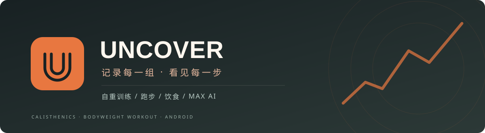

# Uncover · 自重训练

**动作进阶 · 训练计划 · 逐组记录 · 跑步饮食 · MAX AI 助手**

从第一组练习，到下一阶动作，把每一次努力记下来。

**Android ARM64 · 简体中文**

[**下载 APK**](https://github.com/kyirejson/calisthenics-app/releases/latest)　·　[训练内容](#训练内容)　·　[安装说明](docs/INSTALL.md)　·　[问题反馈](https://github.com/kyirejson/calisthenics-app/issues)

## 练什么，怎么练，练到了哪一步

Uncover 是一款面向**自重训练与街头健身**的中文安卓 APP，也提供器械训练专题。动作学习、计划安排、逐组训练和进阶记录连在一起，跑步、饮食和体重记录用于整理训练之外的日常变化。

| 训练之前 | 训练之中 | 训练之后 |
| --- | --- | --- |
| 查动作步骤与配图，选择适合的进阶阶段 | 逐组完成、记录次数或时长、休息计时 | 回看会话、训练日历和进阶记录 |
| 配置计划，安排今日清单 | 中途退出后从剩余组续练 | 根据实际完成情况查看下一阶条件 |

## 训练内容

### 01 · 17 条动作进阶路线

从基础力量到支援练习、爆发技巧，按系列查看各阶动作和掌握条件。

| 系列 | 包含路线 |
| --- | --- |
| **六艺基础** | 俯卧撑、引体向上、深蹲、举腿、桥、倒立撑 |
| **关节与支援** | 抓旗、扬旗、悬挂握力、关节三诀、颈部力量 |
| **爆发六功** | 爆发俯卧撑、爆发跳跃、功夫打挺、前空翻、后空翻、暴力上杠 |

动作详情提供步骤、原文与配图阅读；进阶辅助依据实际训练记录和对应掌握条件。今日训练还可选择**减肥控重与器械专题**，按个人情况配置清单。

### 02 · 把训练记录到每一组

- **今日计划**：按日期组织训练清单，固定开始入口。
- **逐组完成**：记录次数、时长或对应训练量，配合休息计时。
- **中途续练**：未结束的会话保留进度，返回后从剩余组继续。
- **回看历史**：训练日历与逐日记录，可展开查看、管理单次或整日会话。

## 跑步、饮食与体重

| 模块 | 你能看到和记录什么 |
| --- | --- |
| **跑步** | GPS 地图轨迹、距离、配速、公里分段；支持目标、倒计时、专注模式、防误触锁屏与跑后总结 |
| **室内跑步** | Android 可选传感器计步与步长校准，也可手动填写跑步机距离 |
| **饮食** | 今日餐食、已有照片、营养目标估算；可告诉 MAX 自己吃了什么，由助手调用工具记录或更正 |
| **体重** | 记录体重并查看趋势，和训练历史一起回顾 |

跑步结果会关联训练历史；可选自动暂停与语音播报。

## MAX · 能用记录协作的 AI 助手

MAX 连接用户配置的 **DeepSeek API**，结合个人记忆、训练记录和已收录资料提供对话与工具操作。

| 能力 | 使用方式 |
| --- | --- |
| **训练与饮食记录** | 按需读取训练、体重和饮食数据，调用已支持的工具添加、更正或删除饮食记录 |
| **个人记忆** | 保存并读取个人 Markdown 记忆，文本附件也可用于对话 |
| **资料检索** | 检索已收录的训练与营养资料，读取相关原文帮助解释动作和训练问题 |
| **语音交流** | 本地 “Max / Hey Max” 唤醒，文字与语音共用上下文，支持说话打断 |
| **手机与音乐工具** | 单独授权后使用安卓读屏、点击、输入、滚动与音乐控制；可选 Shizuku 支持 |

使用 MAX 需自行配置可用 API Key。语音、锁屏监听和手机操作依赖设备能力及相应授权，详见[使用说明](docs/INSTALL.md#max-助手)。

## 下载与开始

1. 打开 [最新正式版](https://github.com/kyirejson/calisthenics-app/releases/latest)，在 **Assets** 下载 APK。
2. 安装到 **ARM64 安卓手机**，打开后即可安排训练；个人档案可稍后填写。
3. 在“我的”检查更新，保留旧应用直接覆盖安装。

训练、饮食、跑步等记录保存在本机，**更新时不要先卸载或清除数据**。平台要求、联网与数据说明见[安装与使用](docs/INSTALL.md)。

<strong>开发、资料与更新记录</strong>

技术栈：React Native / Expo / TypeScript。

- [开发与功能说明](docs/DEVELOPMENT.md)
- [架构说明](docs/ARCHITECTURE.md)
- [开发工具](scripts/README.md)
- [更新流程](docs/ONLINE-UPDATES.md)
- [更新记录](CHANGELOG.md)
- [许可文件](LICENSE)；第三方资料与资源范围见开发文档及随包许可。

<strong>English · About this app</strong>

**Uncover** is a Chinese-language **Android calisthenics and bodyweight workout app**. It offers seventeen progression routes, workout plans, set-by-set logs, rest timers, resumable sessions, running GPS tracking, nutrition records and weight trends. **MAX** is an optional AI assistant with personal memory, knowledge retrieval and voice interaction, using a user-configured DeepSeek API key. Built with React Native, Expo and TypeScript. Download the ARM64 Android APK from [Releases](https://github.com/kyirejson/calisthenics-app/releases/latest).

